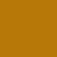
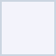
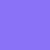
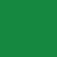
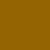

# Apex Paramedics · logo and brand pack

Everything needed to put the Apex Paramedics brand on something. No install, no account, no git.

If you only read one line: use the SVG files, set type in Montserrat, the blue is `#2B338D` and the gold is `#FDB61C`.

If you are building anything with a **chart, a table of numbers or a dashboard**, read [Color for data](#color-for-data) below as well. The blue and gold palette is for the brand. It is deliberately not what you color a chart with.

---

## Download

**[⬇ Download the whole pack](https://github.com/collective-edge/apex-brand-kit/archive/refs/heads/main.zip)** · logos, fonts and this guide in one zip. Unzip it and open the `for-humans` folder.

For one file on its own, click its **SVG** or **PNG** link in the table below, then use the download button on the page that opens.

`Apex-Paramedics-logo-sheet.html` and `data-color-sheet.html` will not render on GitHub. Download them and open them in a browser.

---

## The logos

Pick by the background you are placing it on. The file named **blue** goes on light. The file named **white** goes on dark. The name is the ink of the letters, not the background. The arc is gold in every file.

| | Lockup | Files |
|---|---|---|
|  | **Horizontal · blue**<br>The main logo. `APEX PARAMEDICS` under the gold arc. Use it anywhere it fits. Place on white and light grounds. | [SVG](logos/svg/Apex-Paramedics-horizontal-blue.svg)<br>PNG [1200w](logos/png/Apex-Paramedics-horizontal-blue-1200w.png) · [2400w](logos/png/Apex-Paramedics-horizontal-blue-2400w.png) |
|  | **Horizontal · white**<br>The same lockup for dark blue grounds. | [SVG](logos/svg/Apex-Paramedics-horizontal-white.svg)<br>PNG [1200w](logos/png/Apex-Paramedics-horizontal-white-1200w.png) · [2400w](logos/png/Apex-Paramedics-horizontal-white-2400w.png) |
|  | **Compact · blue**<br>`APEX` alone under the arc. Small places, a deck corner, a narrow column. Place on white and light grounds. | [SVG](logos/svg/Apex-Paramedics-compact-blue.svg)<br>PNG [1200w](logos/png/Apex-Paramedics-compact-blue-1200w.png) · [2400w](logos/png/Apex-Paramedics-compact-blue-2400w.png) |
|  | **Compact · white**<br>The same lockup for dark blue grounds. | [SVG](logos/svg/Apex-Paramedics-compact-white.svg)<br>PNG [1200w](logos/png/Apex-Paramedics-compact-white-1200w.png) · [2400w](logos/png/Apex-Paramedics-compact-white-2400w.png) |
|  | **App icon**<br>The A under the arc, on a dark blue square. Favicons, app tiles, social avatars, and anywhere too small for the compact lockup. It always keeps its square. | [SVG](logos/svg/Apex-Paramedics-app-icon.svg)<br>PNG [512](logos/png/Apex-Paramedics-app-icon-512w.png) · [1024](logos/png/Apex-Paramedics-app-icon-1024w.png) |

**Use the SVG wherever the software will take it.** It is vector, so it stays sharp at any size. The PNGs are for software that will not accept SVG. They have transparent backgrounds, so the white versions look nearly blank until you place them on something dark.

Use the horizontal lockup wherever it fits. The compact one is for places it does not. Under 80 px, use the app icon.


Pasting a URL straight into a design tool works too. The pattern is:

```
https://cdn.jsdelivr.net/gh/collective-edge/apex-brand-kit@main/for-humans/logos/svg/Apex-Paramedics-horizontal-blue.svg
```

**Printing?** The vector master is [`apex-paramedics-PMS123-PMS072.eps`](../assets/logos/source/apex-paramedics-PMS123-PMS072.eps). Send that file to a printer or a sign shop that asks for EPS.

---

## Sizes and spacing

| Rule | Value |
|---|---|
| Clear space on all four sides | Equal to the height of the gold arc |
| Smallest the horizontal lockup may go | 110 px on screen, 1 inch in print |
| Smallest the compact lockup may go | 80 px on screen, 0.75 inch in print |
| Smallest the app icon may go | 16 px on screen |
| Logo width in a letterhead header band | 1.4in to 1.8in |

## Do not

- Stretch, squash, skew or rotate it.
- Recolor it. Pick the file that matches the background instead.
- Change the letters to anything but Apex Blue `#2B338D` or white, or the arc to anything but Apex Gold `#FDB61C`.
- Render the arc in blue or the letters in gold.
- Add a drop shadow, glow, outline or gradient.
- Pull the letters apart from the arc, or use the arc on its own. The arc alone is not an Apex logo.
- Use the compact lockup where the horizontal one fits.
- Put it on a busy photo without a solid backing panel behind it.
- Crop the clear space to make it fit. Shrink the logo instead, down to the minimum.
- Use it below the minimum sizes above.

---

## Color

Blue is the structure. Gold is the spark. Hex and RGB are the authoritative values. Everything else gets converted from these.

| | Name | Hex | RGB | What it is for |
|---|---|---|---|---|
|  | Apex Blue | `#2B338D` | 43, 51, 141 | The primary brand color. The logo letters, headings, links, buttons, accent bars |
|  | Apex Blue Deep | `#1D225E` | 29, 34, 94 | Large dark areas. Header bands, hero backgrounds, footers, table header rows |
|  | Apex Blue Light | `#9699C7` | 150, 153, 199 | Tertiary accents and hover states only |
|  | Apex Gold | `#FDB61C` | 253, 182, 28 | The signature accent, from the arc. Rules under a band, accent marks, numerals on dark blue |
|  | Apex Gold Deep | `#B77808` | 183, 120, 8 | Gold for large text on white |
|  | Charcoal | `#1E293B` | 30, 41, 59 | Body text |
|  | Muted gray | `#64748B` | 100, 116, 139 | Captions, secondary text |
|  | Hairline | `#E2E8F0` | 226, 232, 240 | Table rules, card borders |
|  | Surface | `#f3f3fb` | 243, 243, 251 | Very light blue tint for alternating rows and callout fills |
|  | White | `#FFFFFF` | 255, 255, 255 | Page background |

**These ten colors are for the brand.** They are not the colors you make a chart with. See [Color for data](#color-for-data).

Three things that will bite you, all measured:

- **Apex Gold `#FDB61C` is never text on white.** It measures 1.77:1 and cannot be read. Use it as a rule, an accent mark, or a numeral on a dark blue band, where it measures 8.24:1.
- **Gold text on white is Apex Gold Deep `#B77808`, and only large.** 18pt in print or 24px on screen and up. Never a caption, a table cell or body copy.
- **Apex Blue Light `#9699C7` is never text and never a large background.** On a dark blue background use `#D6DAEC` for body text and `#9EA5C4` for captions.

White text belongs only on Apex Blue or Apex Blue Deep.

For spot color, the letters are Pantone Blue 072 C and the arc is Pantone 1235 C. No CMYK build is specified for this brand. For offset or large-format work, convert from the hex values above and send a proof before the run.

---

## Color for data

Skip this if you are making a logo, a sign or a business card. Read it if anything you are making has a chart, a graph, a dashboard, a scorecard or a table of numbers.

**The brand palette is the wrong tool for a chart.** The old rule said to build a chart from shades of the brand blue. Measured against the standard test for whether two colors can be told apart, the two Apex blues scored 9.6 where the passing mark is 15, and the lightest blue reads as gray. Not "hard for color blind readers". Hard for everybody. So the data colors below are a separate set, and they are the same in every one of our brands.

### The one rule

When there is data on the page, color has a job: separate things, and signal things. The brand is carried by the band at the top, the logo and the typeface. Not by the bars.

### Series colors · telling things apart

For charts with more than one line, bar group or slice. **Use them in this order, starting at the first one.** Do not pick the ones you like. The order is what keeps neighboring colors distinguishable, including for the roughly one man in twelve who cannot separate red from green.

| | Name | On white | On a dark band |
|---|---|---|---|
|  | Purple | `#572e72` | `#be6df2` |
|  | Green | `#1a9d4b` | `#1ba04d` |
|  | Amber | `#dca821` | `#f3ba26` |
|  | Red | `#d42320` | `#e6443a` |
|  | Teal | `#1a97a3` | `#22b6c4` |
|  | Orange | `#e6811c` | `#f78b1f` |
|  | Blue | `#116dce` | `#519dfa` |
|  | Pink | `#e53975` | `#fb608e` |

Slot 1 is purple in every one of our brands. Here it is a data color, not a brand color.

Three of these is the limit on scatter plots, bubble charts and maps, where any two dots can end up touching. Eight is the limit everywhere else. If you need a ninth, group the smallest ones into "Other" or split the chart in two. Do not invent a color.

Amber and orange are light. If a series uses one, put its number directly on the bar or beside the line.

### Direction colors · telling the reader how to feel

Separate from the series colors, and never mixed with them.

| | Name | Hex | Pale fill | Text on that fill |
|---|---|---|---|---|
|  | Favorable | `#158840` | `#daf8df` | `#127e3b` |
|  | Unfavorable | `#db3931` | `#fde9e6` | `#c5372f` |
|  | Caution | `#a36912` | `#fdebd7` | `#95600f` |
|  | Neutral | `#64748B` | `#F1F5F9` | `#51607A` |

**The part that is easy to get backwards.** Green does not mean the number went up. Green means the news is good.

In one of our reports, transports rose 6.3 percent and hospital invoice costs fell 38.8 percent. One number went up, one went down, and both were good news. Both are green. The little arrow shows which way the number moved. The color shows whether that is good.

Coloring a 38.8 percent cost saving red because it has a minus sign in front of it tells the reader we made things worse.

**Always put an arrow or an icon and a word next to the color.** Never the color on its own. Decks get printed in black and white, projected onto washed-out screens, and read by people who cannot see the difference between your red and your green.

### The before-and-after chart

The most common chart we make, and the one most often got wrong.

Do not use a light shade of one color for "before" and a dark shade of it for "after". They are too close together, so the reader has to stop and read the labels to work out which bar is which.

Use a plain gray for the baseline and the first series color for the result:

- Baseline bar · `#CBD5E1`
- Result bar · `#572e72`
- The change, as a pill with an arrow and a word · direction colors above
- The headline number stated once, in dollars rather than a percentage

Gray against purple reads instantly. That is the whole fix.

### The purple ramp · for "how much"

For heatmaps and intensity grids, where one quantity gets darker as it gets bigger. Light to dark:

`#f0e1fd` · `#e2c2fb` · `#d29ef8` · `#ba7ce4` · `#9d60c6` · `#7f42a6` · `#572e72`

It is the same ramp in every one of our brands. Start at the third one for anything with distinct steps, like funnel stages. The first two are so pale they are only usable on a smooth gradient.

**Never use this ramp for things that merely have names.** Facilities, payers and crews are not more or less of anything, and shading them light to dark invents a ranking that is not there. Use the series colors.

### Quick don't list

- Two shades of one color standing in for two different things.
- Red and green as the two ends of one scale. They become the same color for a lot of readers. Use red and teal.
- A red number when the news is good.
- A ninth series color.
- Brand blue on every bar.
- Any color doing its job without a label.

### If you want to check your own work

Everything above was measured rather than picked by eye. If you have a set of colors you want tested, send them to us and we will run them, or run it yourself from the repository:

```
python3 scripts/validate-palette.py "#572e72,#1a9d4b,#d42320"
```

It reports whether the colors are distinguishable, including under the common forms of color blindness, and whether they have enough contrast against the page.

---

## Type

The brand is set in **Montserrat** throughout. There is no secondary typeface.

The four weights the brand uses are in [`fonts/static/`](fonts/static/), one file each. Install these if your software asks for a font file: Word, PowerPoint, Keynote, a handbook platform, a sign shop.

| Weight | File | Used for |
|---|---|---|
| Regular 400 | [`Montserrat-Regular.ttf`](fonts/static/Montserrat-Regular.ttf) | Body text |
| SemiBold 600 | [`Montserrat-SemiBold.ttf`](fonts/static/Montserrat-SemiBold.ttf) | Labels, subheads, emphasis |
| Bold 700 | [`Montserrat-Bold.ttf`](fonts/static/Montserrat-Bold.ttf) | Headings |
| ExtraBold 800 | [`Montserrat-ExtraBold.ttf`](fonts/static/Montserrat-ExtraBold.ttf) | Display statements on a band or title |

There is no italic in this brand, at any weight. Do not set one and do not let software fake one.

The single variable font file in [`fonts/`](fonts/) carries every weight in one file, for web and design tools that read a weight axis. Montserrat is also free from Google Fonts at https://fonts.google.com/specimen/Montserrat.

Headings are bold. Display statements on a title, band or divider are uppercase and letter-spaced, and never run past four words. Headings inside a document are sentence case.

## Writing, if you are setting copy

- Short declarative sentences. Active verbs. Nothing before the point.
- No em dashes. Use a period, a comma, or `·`.
- A label and a value, nothing between them. No helper text under a field, no caption restating the number above it.
- Name partners and facilities exactly the way they write themselves.

---

## Photos

This pack ships no photography yet. Ask for it. Do not pull an image from a search engine or a stock library to stand in.

---

## What is in this folder

```
for-humans/
├── README.md                          You are reading it
├── Apex-Paramedics-logo-sheet.html    Open in a browser. Every logo and color on one page
├── data-color-sheet.html              Open in a browser. Every chart color on one page
├── logos/svg/                         Vector. Use these
├── logos/png/                         Raster, transparent background
├── previews/                          The images shown above
├── fonts/                             The brand typeface, variable file
│   └── static/                        Regular, SemiBold, Bold, ExtraBold as single files
└── pack.json                          The list this folder is built from. Ignore it
```

## The other brands in the house

Three brands, one type system. Each has the same pack in the same place.

| Brand | Pack |
|---|---|
| Collective Edge · the parent | [collective-edge-brand-kit/for-humans](https://github.com/collective-edge/collective-edge-brand-kit/tree/main/for-humans) |
| Royal Ambulance | [royal-brand-kit/for-humans](https://github.com/collective-edge/royal-brand-kit/tree/main/for-humans) |

## Questions

Anything this folder does not answer, ask before you guess. The brand owner would rather answer a question than correct a proof.
